# 🛸 MedusaAlfa × WebGL Drone Sim

**Один проєкт = комп'ютерний зір + керування дроном жестами + 3D-симулятор у браузері.**

Проєкт об'єднує два раніше незалежні модулі:

| Модуль | Що робив | Що став |
|---|---|---|
| **MedusaAlfa** (`test_eye`) | Розпізнавання хазяїна (YOLOv8-pose + face_recognition), трекінг рук (MediaPipe) | Джерело команд: жести рук → вектор керування |
| **web_drone_sim** | WebGL-симулятор дрона (Three.js) + WebSocket-релей | Виконавець команд: літає, сідає, повертається |

Тепер **достатньо однієї команди** `python3 medusa_webcam.py` — і програма:

1. піднімає симулятор на `http://127.0.0.1:8000` та відкриває браузер;
2. вмикає камеру й розпізнає вас як **хазяїна** (біометрія обличчя);
3. знаходить ваші руки (MediaPipe, 21 точка) і **розпізнає жести**;
4. перетворює жест у вектор `[v_x, v_y, v_z, yaw_rate, action]` і 20 разів на секунду шле його симулятору через WebSocket;
5. показує у вікні відео тактичний HUD: жест → команда → вектор → стан зв'язку → телеметрія дрона.

> ⚠️ Керування активне **лише для жестів хазяїна** — руки сторонніх людей ігноруються,
> бо MediaPipe-скелет береться тільки для тіла, чиє обличчя збіглося з профілем хазяїна.

---

## 📑 Зміст

- [Швидкий старт](#-швидкий-старт)
- [Вимоги](#-вимоги)
- [Встановлення](#-встановлення)
- [Запуск](#-запуск)
- [Жести та команди](#-жести-та-команди)
- [Протокол команд (вектор)](#-протокол-команд-вектор)
- [Як це працює всередині](#-як-це-працює-всередині)
- [Структура репозиторію](#-структура-репозиторію)
- [Клавіші та CLI](#-клавіші-та-cli)
- [Тести](#-тести)
- [Проблеми та рішення](#-проблеми-та-рішення)
- [GitHub: клонувати / запулити / запустити](#-github-клонувати--запулити--запустити)
- [Як додати свій жест або підключити реальний дрон](#-як-додати-свій-жест-або-підключити-реальний-дрон)

---

## ⚡ Швидкий старт

```bash
# 1. Клонувати
git clone https://github.com/fawerty505-art/MedusaAlfa MedusaAlfa
cd MedusaAlfa

# 2. Віртуальне середовище + залежності
python3 -m venv .venv
source .venv/bin/activate            # Windows: .venv\Scripts\activate
python3 -m pip install --upgrade pip
python3 -m pip install -r requirements.txt

# 3. Запустити ВСЕ (симулятор + камера + жести)
python3 medusa_webcam.py
```

Що станеться далі:

1. у терміналі з'явиться банер із адресою симулятора;
2. автоматично відкриється браузер на `http://127.0.0.1:8000` (якщо ні — відкрийте вручну);
3. відкриється вікно з камерою **«Medusa Eye // ESP32 VGA Simulator»**;
4. станьте перед камерою та натисніть **`R`** — обличчя запам'ятається як хазяїн;
5. покажіть долоню → дрон тримає позицію; покажіть ☝️ → злітає; ✌️ → летить до вас.

**Камера ESP32-CAM замість веб-камери:**

```bash
python3 medusa_eye.py --ip 10.52.127.86 --port 80
```

---

## 💻 Вимоги

| Компонент | Версія / примітка |
|---|---|
| Python | **3.9 – 3.14** (перевірено на 3.14.3) |
| ОС | macOS, Linux, Windows (з веб-камерою) |
| Браузер | Chrome / Safari / Firefox з WebGL (для симулятора) |
| Інтернет | потрібен **перший раз** — завантажуються моделі (`yolov8n-pose.pt`, `hand_landmarker.task`) і Three.js з CDN |
| Камера | вбудована веб-камера **або** ESP32-CAM (TCP-стрім) |
| CPU | будь-який сучасний; GPU не обов'язковий (YOLOv8n-pose працює на CPU ~14 мс/кадр) |

Порти, які мають бути вільними: **8000** (HTTP-UI симулятора) і **8765** (WebSocket-релей).

---

## 🔧 Встановлення

### 1. Системні залежності

`face_recognition` використовує `dlib`, а той компілюється з вихідних кодів — потрібні CMake і компілятор.

**macOS**

```bash
brew install cmake
xcode-select --install        # якщо ще не встановлено
```

**Ubuntu / Debian**

```bash
sudo apt update
sudo apt install -y python3-venv python3-dev build-essential cmake \
                    libopenblas-dev liblapack-dev libx11-dev libgtk-3-dev
```

**Windows**

Для Windows використовуйте Python 3.13 та готовий `dlib-bin` wheel, щоб не
компілювати dlib із вихідного коду:

```powershell
py -3.13 -m venv .venv
.\.venv\Scripts\python.exe -m pip install --upgrade pip wheel "setuptools<81"
.\.venv\Scripts\python.exe -m pip install -r requirements.txt
.\.venv\Scripts\python.exe -m pip install dlib-bin face-recognition-models
.\.venv\Scripts\python.exe -m pip install --no-deps face-recognition
```

### 2. Python-середовище

```bash
python3 -m venv .venv
source .venv/bin/activate              # Windows: .venv\Scripts\activate

python3 -m pip install --upgrade pip wheel
python3 -m pip install -r requirements.txt
```

> ⚠️ **Не робіть `pip install --upgrade setuptools`.** `face_recognition_models` виконує
> `import pkg_resources`, а починаючи з `setuptools 82` цього модуля немає — програма впаде при
> старті. `requirements.txt` уже фіксує `setuptools<81`. Якщо все ж зламали:
> `python3 -m pip install "setuptools<81"`.

`requirements.txt` містить:

```
opencv-python   mediapipe   ultralytics   numpy   websockets
```

На Windows `face-recognition` встановлюється окремо командами вище, щоб
використати готовий `dlib-bin` замість компіляції dlib.

### 3. Моделі (завантажуються автоматично)

| Файл | Куди | Коли |
|---|---|---|
| `hand_landmarker.task` (~7.5 МБ) | `models/` | при першому запуску, якщо файлу немає |
| `yolov8n-pose.pt` (~6.8 МБ) | `models/` | при першому запуску (Ultralytics) |
| `owner_face.npy` | `data/` | створюється вами клавішею `R` |

Усі три файли є у `.gitignore` — у репозиторії їх немає (моделі качаються, біометрія не публікується).

Якщо інтернету немає — завантажте вручну:

```bash
mkdir -p models data
curl -L -o models/hand_landmarker.task \
  https://storage.googleapis.com/mediapipe-models/hand_landmarker/hand_landmarker/float16/1/hand_landmarker.task
# yolov8n-pose.pt: https://github.com/ultralytics/assets/releases
```

---

## 🚀 Запуск

### Варіант A — веб-камера (основний, для тестів)

```bash
python3 medusa_webcam.py
```

### Варіант B — ESP32-CAM

```bash
python3 medusa_eye.py --ip 192.168.1.50 --port 80   # замініть на IP з Serial Monitor
python3 medusa_eye.py --source webcam          # те саме, що варіант A
```

On Windows PowerShell, from the repository root, use:

```powershell
.\.venv\Scripts\Activate.ps1
py .\medusa_eye.py --ip 192.168.1.50 --port 80
```

Replace `192.168.1.50` with the current IP printed by the ESP32. The firmware
listens on TCP port 80 and expects the client to send `START` before streaming;
`medusa_eye.py` handles that handshake automatically.

### Варіант C — симулятор уже запущений окремо

```bash
# термінал 1
python3 sim/server.py

# термінал 2
python3 medusa_webcam.py --no-sim
```

### Варіант D — тільки симулятор (без CV)

```bash
python3 sim/server.py                        # http://127.0.0.1:8000
python3 sim/test_sender.py                   # демонстраційний політ (скриптований)
python3 sim/test_sender.py --loop            # нескінченний політ
```

### Що ви побачите

**Вікно відео (OpenCV):**

- жовтий квадрат — тіло хазяїна, зелений — обличчя (слідує за нахилом голови);
- рожево-фіолетовий скелет — кисті рук хазяїна;
- права нижня панель — `GESTURE FLIGHT CONTROL`: розпізнаний жест, вектор, стан WebSocket, телеметрія дрона (статус, висота, курс);
- по центру — велике підтвердження `TAKEOFF` / `LAND`.

**Браузер:** 3D-сцена 50×50 м, дрон, HUD із телеметрією; у лівому верхньому куті індикатор `WS: CONNECTED`.

---

## ✋ Жести та команди

Керує **права рука** (перемикається `--hand Left|any`). Розпізнається **кількість розігнутих пальців**
(геометрія стійка до повороту кисті, масштабу та освітлення):

| Жест | Пальці | Вектор (за замовчуванням) | Дія дрона |
|---|---|---|---|
| ✋ Долоня (великий палець не важливий) | 4 | `[0, 0, 0, 0, 0]` | **HOVER** — тримати позицію |
| ✊ Кулак | 0 | `[0, 0, 0, 0, 2]` | **LAND** — сісти |
| ☝️ Вказівний | 1 | `[0, 0, 0, 0, 1]` | **TAKEOFF** — злетіти на 2 м |
| ✌️ V (два) | 2 | `[+1.5, 0, 0, 0, 0]` | **FORWARD** — наблизитися до вас |
| 🤟 Три | 3 | `[-1.2, 0, 0, 0, 0]` | **BACKWARD** — відлетіти назад |
| 👍 Тільки великий | 👍 | `[0, 0, +0.9, 0, 0]` | **CLIMB** — піднятися |
| 🤘 Вказівний + мізинець | 2 | `[0, 0, -0.9, 0, 0]` | **DESCEND** — опуститися |

**Поворот (yaw).** Додатково до жесту: якщо рука зміщена **ліворуч/праворуч від центру кадру**, додається
`yaw_rate` (до ±55 °/с, мертва зона 22 %). Працює для «польотних» жестів і не впливає на кулак/вказівний.
Напрямок рахується **від користувача**: веб-камера й ESP32 дають недзеркальний кадр, тому рука, піднесена
праворуч від вас, з'являється ліворуч у кадрі — і дрон повертає вправо. Якщо ваша камера показує
дзеркальне зображення (selfie) — додайте `--mirrored`; якщо напрямок усе одно «не туди» — `--yaw-invert`.

**Права/ліва рука.** MediaPipe очікує дзеркальний кадр і тому для звичайної камери плутає руки;
програма це враховує, тож `--hand Right` — це справді *ваша* права рука.

**Чому долоня не залежить від великого пальця.** Розслаблена відкрита рука часто тримає великий палець біля
долоні. Якби від нього залежало «hover» чи «вниз», природний жест «стоп» опускав би дрон. Тому «вниз» —
свідомий жест 🤘 (вказівний + мізинець).

Повну таблицю у терміналі:

```bash
python3 medusa_webcam.py --gestures-table
```

**Захист від випадкових команд:**

| Механізм | Значення | Навіщо |
|---|---|---|
| Стабільність жесту | 0.18 с (`--stable-time`) | випадкове «мерехтіння» пальців не змінює команду |
| Частота відправки | 20 Гц (`--link-rate`) | симулятор отримує свіжий вектор |
| Safety-timeout симулятора | 0.5 с | немає даних → дрон плавно переходить у hover |
| Хазяїн зник з кадру | 8 с (`--auto-land`) | автоматичний `LAND` (0 = вимкнути). Якщо хазяїн у кадрі, а руки не видно — просто hover |
| Миготіння руки | 0.35 с | один кадр без детекції не перериває маневр |
| Застарілі команди | 0.4 с | вектор старший за 0.4 с не повторюється: завис цикл або натиснуто `G` → мовчання → hover у симуляторі |
| Тільки руки хазяїна | — | сторонні люди не керують дроном |
| Головний вимикач | `G` / `--no-gestures` | миттєво припинити команди |


---

## 🔌 Протокол команд (вектор)

Симулятор приймає рівно **5 чисел** (JSON-масив):

```
[v_x, v_y, v_z, yaw_rate, action]
```

| Поле | Од. | Система координат | Додатне значення |
|---|---|---|---|
| `v_x` | м/с | **корпус дрона** | вперед (ніс) |
| `v_y` | м/с | **корпус дрона** | вправо |
| `v_z` | м/с | світова вертикаль | вгору |
| `yaw_rate` | °/с | — | поворот за годинниковою стрілкою (вправо) |
| `action` | — | — | `0` HOVER · `1` TAKEOFF (2 м) · `2` LAND · `3` RESET |

Симулятор додатково приймає `{"cmd": [...]}` та `{"vector": [...]}` і сам обмежує швидкості:

| Ліміт | Значення |
|---|---|
| Горизонтальна швидкість | 8 м/с |
| Вертикальна швидкість | 4 м/с |
| Yaw rate | 180 °/с |
| Висота | 40 м |
| Геозона | ±24.5 м |
| Safety-timeout | 0.5 с без вектора → hover |

**Двобічний обмін** (WebSocket-релей `sim/server.py`):

```
python (MedusaAlfa)  --[vx,vy,vz,yaw,action]-->  server.py  -->  браузер (app.js)
python (MedusaAlfa)  <--{"telemetry":{...}}----  server.py  <--  браузер
```

Приклад телеметрії, яку читає HUD:

```json
{"telemetry": {"x": 1.2, "y": 2.14, "z": -0.4, "heading": 92.5, "status": "FLYING"}}
```

Перевірити канал без камери (браузер має бути відкритий — релей пересилає вектор *іншим* клієнтам):

```bash
python3 - <<'PY'
import asyncio, json, websockets
async def main():
    async with websockets.connect("ws://127.0.0.1:8765") as ws:
        for v in ([0,0,0,0,1], [1.5,0,0,0,0], [0,0,0,0,2]):
            await ws.send(json.dumps(v)); await asyncio.sleep(1.5)
asyncio.run(main())
PY
```

> Порти можна змінювати (`--http-port`, `--ws-port`): сторінка отримує фактичний WS-порт
> з `/sim-config.js`, який генерує `sim/server.py`, тому нічого правити в JS не потрібно.

---

## 🧠 Як це працює всередині

```mermaid
flowchart LR
    CAM["📷 ThreadedCamera / ESP32Stream<br/>(фоновий потік, 0 мс)"] --> YOLO["🎯 YOLOv8n-pose + ByteTrack<br/>imgsz=320, ~14 мс"]
    YOLO --> PEOPLE["Тіла людей + 17 keypoints"]
    PEOPLE --> CROP["✂️ Кроп голови за носом/очима"]
    CROP --> FACE["🧠 face_recognition (dlib)<br/>поріг 0.52"]
    FACE --> OWNER["🔒 owner_track_id"]
    OWNER --> MP["✋ MediaPipe HandLandmarker<br/>21 точка, VIDEO mode"]
    MP --> GEST["🖐 gestures.py<br/>Posture + debounce 0.18 с"]
    GEST --> MAP["📐 GestureMapper -> [vx,vy,vz,yaw,action]"]
    MAP --> LINK["🔗 DroneLink<br/>ws://127.0.0.1:8765, 20 Гц"]
    LINK --> SRV["🛰 sim/server.py<br/>WebSocket-релей"]
    SRV --> WEB["🌐 sim/app.js (Three.js)<br/>фізика + HUD"]
    WEB -.->|telemetry| SRV
    SRV -.->|telemetry| LINK
```



**Потоки в процесі Python:**

| Потік | Що робить |
|---|---|
| Головний | OpenCV-цикл: кадр → YOLO → руки → жест → HUD → `cv2.imshow` |
| `ThreadedCamera` (або ESP32) | безперервно читає кадри, щоб `read()` ніколи не блокувався |
| `AsyncFaceVerifier` | біометрія обличчя у фоні (не гальмує FPS) |
| `DroneLink` | окремий asyncio-цикл у своєму потоці: connect / send 20 Гц / recv телеметрії / reconnect |
| `sim/server.py` | **окремий процес**: HTTP-сервер (потік) + WebSocket-релей (asyncio) |

**Модулі пакета `medusa/`:**

| Файл | Відповідальність |
|---|---|
| `eye.py` | `MedusaEye`: камера, YOLO-pose, біометрія, MediaPipe, HUD, головний цикл |
| `esp32_stream.py` | TCP-клієнт ESP32-CAM (4-байтна довжина кадру + JPEG) |
| `gestures.py` | Геометрія кисті → `Posture` → `DroneCommand` (без залежностей від CV — легко тестувати) |
| `controller.py` | `GestureDroneController`: жест + зв'язок + режим ON/OFF |
| `drone_link.py` | `DroneLink`: потокобезпечний WebSocket-клієнт із автоперепідключенням |
| `sim_launcher.py` | `SimLauncher`: піднімає/зупиняє `sim/server.py`, відкриває браузер |
| `overlay.py` | Панель `GESTURE FLIGHT CONTROL` та підтвердження дій |
| `paths.py` | Єдині шляхи (`models/`, `data/`, `sim/`) від кореня репозиторію |
| `cli.py` | Спільний CLI для `medusa_webcam.py` / `medusa_eye.py` |

**Чому жест = кількість пальців, а не пози?** Кількість розігнутих пальців обчислюється через
порівняння відстаней «кінчик↔зап'ястя» та «PIP↔зап'ястя» — це інваріантно до повороту кисті,
відстані до камери та кута нахилу. Пози (наприклад, «великий палець вгору») ламаються при
повороті руки на 90°.

---

## 📂 Структура репозиторію

```
MedusaAlfa/
├── medusa_webcam.py          ← ЗАПУСК №1: веб-камера + симулятор + жести
├── medusa_eye.py             ← ЗАПУСК №2: ESP32-CAM + симулятор + жести
├── requirements.txt
├── README.md
├── .gitignore
│
├── medusa/                   ← комп'ютерний зір + керування
│   ├── eye.py
│   ├── esp32_stream.py
│   ├── gestures.py
│   ├── controller.py
│   ├── drone_link.py
│   ├── sim_launcher.py
│   ├── overlay.py
│   ├── paths.py
│   └── cli.py
│
├── sim/                      ← симулятор дрона
│   ├── server.py             HTTP :8000 + WebSocket :8765
│   ├── index.html            HUD + завантаження Three.js r128
│   ├── app.js                фізика дрона, 3D-сцена, WebSocket-клієнт
│   ├── styles.css
│   └── test_sender.py        демонстраційний політ
│
├── models/                   (у git лише .gitkeep — моделі качаються самі)
├── data/                     (у git лише .gitkeep — owner_face.npy ігнорується)
└── tests/
    ├── test_gestures.py      розпізнавання жестів і мапінг (без камери)
    ├── test_controller.py    контролер жестів
    ├── test_drone_link.py    наскрізний тест: link → server.py → «браузер»
    └── test_esp32_stream.py  протокол ESP32-CAM
```


---

## ⌨️ Клавіші та CLI

### Клавіші у вікні відео

| Клавіша | Дія |
|---|---|
| **`G`** | Увімкнути / вимкнути керування дроном жестами (CV продовжує працювати) |
| **`R`** | Зареєструвати хазяїна (дивіться в камеру) → `data/owner_face.npy` |
| **`C`** | Скинути профіль хазяїна |
| **`D`** | Debug-HUD (Track ID, кількість рук, поточна поза) |
| **`Q`** / **`Esc`** | Вихід (гасить симулятор, якщо його запускали ми) |

### Клавіші у браузері (симулятор)

| Клавіша | Дія |
|---|---|
| `C` | Камера ORBIT ↔ FOLLOW |
| `M` | Ручне керування з клавіатури (WASD / Space / Shift / QE) |
| `T` / `L` / `R` | Takeoff / Land / Reset |

### Основні опції CLI

```bash
python3 medusa_webcam.py --help            # повний список
python3 medusa_webcam.py --gestures-table  # таблиця жестів і векторів
```

| Опція | За замовчуванням | Опис |
|---|---|---|
| `--source {webcam,esp32}` | `webcam` (`medusa_eye.py`: `esp32`) | джерело відео |
| `--camera N` | `0` | індекс локальної камери |
| `--ip`, `--port` | `10.52.127.86`, `80` | адреса ESP32-CAM; використовуйте актуальну IP з Serial Monitor |
| `--no-sim` | — | не запускати симулятор (уже працює) |
| `--no-browser` | — | не відкривати браузер |
| `--http-port`, `--ws-port` | `8000`, `8765` | порти симулятора |
| `--ws-url` | — | готовий `ws://…` (перекриває порти) |
| `--no-gestures` | — | тільки CV, без команд |
| `--hand {Right,Left,any}` | `Right` | яка рука керує |
| `--no-yaw-from-hand` | — | вимкнути поворот від зміщення руки |
| `--yaw-gain`, `--yaw-deadzone`, `--yaw-invert` | `55`, `0.22`, — | налаштування повороту |
| `--mirrored` | — | кадр дзеркальний (selfie); для webcam/ESP32 за замовчуванням не потрібен |
| `--approach-speed` | `1.5` м/с | швидкість «до вас» (✌️) |
| `--retreat-speed` | `1.2` м/с | швидкість «назад» (🤟) |
| `--climb-speed`, `--descend-speed` | `0.9`, `0.9` м/с | вертикальні швидкості |
| `--stable-time` | `0.18` с | скільки жест має протриматись |
| `--auto-land` | `8` с | авто-`LAND`, якщо хазяїн зник (0 = вимкнути) |
| `--link-rate` | `20` Гц | частота відправки векторів |

Приклади:

```bash
# повільніше й безпечніше
python3 medusa_webcam.py --approach-speed 0.8 --climb-speed 0.4 --descend-speed 0.4 --auto-land 5

# керування лівою рукою, без повороту від руки
python3 medusa_webcam.py --hand Left --no-yaw-from-hand

# тільки розпізнавання (без команд) — для відлагодження CV
python3 medusa_webcam.py --no-gestures

# зовнішня USB-камера
python3 medusa_webcam.py --camera 1

# симулятор на інших портах
python3 medusa_webcam.py --http-port 8100 --ws-port 8766
```

---

## 🧪 Тести

Усі тести працюють **без камери** — кисть синтезується геометрично (21 точка), а симулятор
піднімається як справжній підпроцес на вільних портах.

```bash
python3 -m unittest discover -s tests -v
```

Очікуваний результат:

```
Ran 65 tests in ~8s
OK
```

| Файл | Що перевіряє |
|---|---|
| `tests/test_gestures.py` | пальці/пози, мапінг у вектор, анти-дриґання, авто-лендінг, yaw, вибір руки |
| `tests/test_controller.py` | `GestureDroneController`: відправка, режим OFF, `toggle`, `close` |
| `tests/test_drone_link.py` | `DroneLink` + реальний `sim/server.py`: доставка вектора «браузеру», телеметрія, offline-стан |
| `tests/test_esp32_stream.py` | TCP-протокол ESP32-CAM (4-байтна довжина + JPEG) |


---

## 🩺 Проблеми та рішення

| Симптом | Причина | Рішення |
|---|---|---|
| `Missing dependency … websockets` | не встановлені залежності | `python3 -m pip install -r requirements.txt` |
| `Cannot bind HTTP port 8000` | порт зайнятий | закрийте старий запуск або `--http-port 8100 --ws-port 8766` |
| Браузер показує `WS: DISCONNECTED` | симулятор не запущено / інший порт | перевірте, що `sim/server.py` живе; `--ws-url ws://127.0.0.1:8765` |
| Дрон не рухається, у HUD `LINK: OFFLINE` | Python не підключився до WS | дивіться термінал — там буде причина; перевірте порт |
| `Не вдалося отримати відео з камери` | macOS не дав дозвіл / камера зайнята | System Settings → Privacy → Camera → Terminal/VS Code; закрийте Zoom/Meet |
| Чорний екран у вікні відео | інший індекс камери | `--camera 1`, `--camera 2` |
| `NO OWNER REGISTERED` | профіль не створено | натисніть `R`, дивлячись у камеру |
| Хазяїн не фіксується | обличчя закрите / далеко | підійдіть ближче, зніміть маску, `D` для debug |
| Жести не розпізнаються | рука не в кадрі / погане світло | тримайте кисть повністю в кадрі, долоня до камери |
| Дрон смикається між командами | жести нестабільні | збільшіть `--stable-time 0.3` |
| Дрон повертає не в той бік | дзеркальна камера / інша орієнтація | `--mirrored` або `--yaw-invert` |
| `ModuleNotFoundError: pkg_resources` | `setuptools` ≥ 82 | `python3 -m pip install "setuptools<81"` |
| `hand_landmarker.task` не качається | немає інтернету | завантажте вручну (див. «Моделі») |
| `Could not build wheels for dlib` | немає CMake/компілятора | `brew install cmake` / `apt install cmake build-essential` |
| Низький FPS (< 15) | слабкий CPU | закрийте зайві програми; зменште `YOLO_IMGSZ` у `medusa/eye.py` |
| Вікно відео не закривається | завис OpenCV GUI | `Q` / `Esc`, потім Ctrl+C у терміналі |

У терміналі видно кожну зміну жесту — це найшвидший спосіб зрозуміти, де саме «застрягло»:

```
🖐  Posture.VICTORY -> FORWARD / APPROACH  [+1.50, +0.00, +0.00, +0.0, 0]  (link: CONNECTED)
```

---

## 🌍 GitHub: клонувати / запулити / запустити

### Перший push (репозиторій з нуля)

```bash
cd MedusaAlfa
git init -b main
git add .
git commit -m "MedusaAlfa: CV owner recognition + hand gestures -> WebGL drone simulator"
git remote add origin https://github.com/<ВАШ_ЛОГІН>/<ВАШ_РЕПОЗИТОРІЙ>.git
git push -u origin main
```

> `.gitignore` уже виключає `models/*.pt`, `models/*.task`, `data/*.npy`, `.venv/`, `__pycache__/`,
> а також легасі-папки `MedusaAlfa/` і `web_drone_sim/` (залишки злиття).
> **Не додавайте їх у git**: вкладений `.git` перетворюється на gitlink, і після клонування
> на місці папки буде порожнеча.

### Хто клонує репозиторій

```bash
git clone https://github.com/<ЛОГІН>/<РЕПО>.git
cd <РЕПО>
python3 -m venv .venv && source .venv/bin/activate
python3 -m pip install -r requirements.txt
python3 medusa_webcam.py
```

Перший запуск сам завантажить моделі (~15 МБ) і відкриє симулятор. Профіль хазяїна створюється
локально клавішею `R` — у репозиторії його немає (персональні дані).

### Оновлення (pull)

```bash
git pull
python3 -m pip install -r requirements.txt   # якщо змінилися залежності
python3 medusa_webcam.py
```

---

## 🧩 Як додати свій жест або підключити реальний дрон

### 1. Новий жест

Усе в одному файлі — `medusa/gestures.py`:

```python
# 1) додати позу
class Posture(str, Enum):
    ...
    SHAKA = "shaka"

# 2) навчити класифікатор (у classify_posture)
if count == 0 and thumb and pinky:
    return Posture.SHAKA

# 3) призначити команду
Posture.SHAKA: GestureBinding("ROTATE LEFT", yaw=-60.0, allow_yaw=False)   # yaw — фіксований °/с
```

`eye.py` змінювати не потрібно — `GestureMapper` підхопить новий біндінг.
Додайте кейс у `tests/test_gestures.py` (див. `make_hand`) — і жест захищений тестом.

### 2. Плавне (пропорційне) керування

`GestureMapper._yaw_rate()` — приклад того, як неперервний параметр (зміщення руки)
стає `yaw_rate`. За тим самим принципом можна додати висоту:

```python
def _climb_rate(self, points, frame_height):
    _, cy = palm_center(points)
    offset = (cy - frame_height / 2) / (frame_height / 2)   # + = рука нижче центру
    return -offset * 0.8                                     # рука вище -> вгору
```

### 3. Реальний дрон замість симулятора

`DroneLink` — єдина точка, де вектор виходить назовні. Замініть `_send_loop`
(або підкладіть інший об'єкт із методами `send(command)` / `hover()`) на:

- **MAVLink** (`pymavlink` → `set_position_target_local_ned` / `set_attitude_target`);
- **ROS 2** (`rclpy` → `geometry_msgs/Twist`);
- **власний UDP/TCP** протокол ESP32-польотного контролера.

Решта системи (CV, жести, HUD, safety-логіка) не змінюється — саме для цього протокол
і зроблений вузьким: `[v_x, v_y, v_z, yaw_rate, action]`.

---

## 🛡️ Безпека та обмеження

- Це **симулятор**: команди в реальний дрон не йдуть, поки ви самі не заміните `DroneLink`.
- Симулятор має власні ліміти швидкості/висоти/геозони — навіть «божевільний» вектор не вилетить за поле.
- Біометричний профіль (`data/owner_face.npy`) — персональні дані: не комітьте його.
- Керування жестами вимикається клавішею `G` у будь-який момент (дрон перейде в hover за 0.5 с).
- Якщо хазяїн зникає з кадру на 8 с — автоматичний `LAND`.

---

## 📜 Ліцензія

Навчальний / дослідницький проєкт. Сторонні компоненти зберігають свої ліцензії:
Ultralytics YOLOv8 (AGPL-3.0), MediaPipe (Apache-2.0), face_recognition (MIT), Three.js (MIT).
