# 🛸 MedusaAlfa × WebGL Drone Sim

**One project = computer vision + gesture drone control + a 3D simulator in the browser.**

The project merges two previously independent modules:

| Module | What it did | What it became |
|---|---|---|
| **MedusaAlfa** (`test_eye`) | Owner recognition (YOLOv8-pose + face_recognition), hand tracking (MediaPipe) | Command source: hand gestures → control vector |
| **web_drone_sim** | WebGL drone simulator (Three.js) + WebSocket relay | Command executor: takes off, lands, turns |

Now **a single command** — `python3 medusa_webcam.py` — is enough. The program:

1. starts the simulator at `http://127.0.0.1:8000` and opens the browser;
2. turns on the camera and recognizes you as the **owner** (face biometrics);
3. finds your hands (MediaPipe, 21 landmarks) and **recognizes gestures**;
4. converts a gesture into a vector `[v_x, v_y, v_z, yaw_rate, action]` and sends it to the simulator over WebSocket 20 times per second;
5. shows a tactical HUD in the video window: gesture → command → vector → link status → drone telemetry.

> ⚠️ Control is active **only for the owner's gestures** — hands of other people are ignored,
> because the MediaPipe skeleton is only taken for the body whose face matched the owner's profile.

---

## 📑 Table of contents

- [Quick start](#-quick-start)
- [Requirements](#-requirements)
- [Installation](#-installation)
- [Running](#-running)
- [Gestures and commands](#-gestures-and-commands)
- [Command protocol (vector)](#-command-protocol-vector)
- [How it works internally](#-how-it-works-internally)
- [Repository structure](#-repository-structure)
- [Keys and CLI](#-keys-and-cli)
- [Tests](#-tests)
- [Troubleshooting](#-troubleshooting)
- [GitHub: clone / pull / run](#-github-clone--pull--run)
- [How to add your own gesture or connect a real drone](#-how-to-add-your-own-gesture-or-connect-a-real-drone)

---

## ⚡ Quick start

```bash
# 1. Clone
git clone https://github.com/fawerty505-art/MedusaAlfa MedusaAlfa
cd MedusaAlfa

# 2. Virtual environment + dependencies
python3 -m venv .venv
source .venv/bin/activate            # Windows: .venv\Scripts\activate
python3 -m pip install --upgrade pip
python3 -m pip install -r requirements.txt

# 3. Run EVERYTHING (simulator + camera + gestures)
python3 medusa_webcam.py
```

What happens next:

1. a banner with the simulator address appears in the terminal;
2. the browser opens automatically at `http://127.0.0.1:8000` (if not, open it manually);
3. a camera window **"Medusa Eye // ESP32 VGA Simulator"** opens;
4. stand in front of the camera and press **`R`** — your face is remembered as the owner;
5. show an open palm → the drone holds position; show ☝️ → it takes off; ✌️ → it flies toward you.

**ESP32-CAM instead of a webcam:**

```bash
python3 medusa_eye.py --ip 10.21.246.241 --port 80
```

---

## 💻 Requirements

| Component | Version / note |
|---|---|
| Python | **3.9 – 3.14** (tested on 3.14.3) |
| OS | macOS, Linux, Windows (with a webcam) |
| Browser | Chrome / Safari / Firefox with WebGL (for the simulator) |
| Internet | required **the first time** — models (`yolov8n-pose.pt`, `hand_landmarker.task`) and Three.js from a CDN are downloaded |
| Camera | built-in webcam **or** ESP32-CAM (TCP stream) |
| CPU | any modern one; a GPU is not required (YOLOv8n-pose runs on CPU at ~14 ms/frame) |

Ports that must be free: **8000** (simulator HTTP UI) and **8765** (WebSocket relay).

---

## 🔧 Installation

### 1. System dependencies

`face_recognition` uses `dlib`, which is compiled from source — you need CMake and a compiler.

**macOS**

```bash
brew install cmake
xcode-select --install        # if not installed yet
```

**Ubuntu / Debian**

```bash
sudo apt update
sudo apt install -y python3-venv python3-dev build-essential cmake \
                    libopenblas-dev liblapack-dev libx11-dev libgtk-3-dev
```

**Windows**

1. Install [CMake](https://cmake.org/download/) and **Visual Studio Build Tools** (Desktop development with C++).
2. Use Python 3.10–3.12 (best compatibility with `dlib`/`mediapipe`).

### 2. Python environment

```bash
python3 -m venv .venv
source .venv/bin/activate              # Windows: .venv\Scripts\activate

python3 -m pip install --upgrade pip wheel
python3 -m pip install -r requirements.txt
```

> ⚠️ **Do not run `pip install --upgrade setuptools`.** `face_recognition_models` executes
> `import pkg_resources`, and starting with `setuptools 82` that module no longer exists — the program will crash on
> startup. `requirements.txt` already pins `setuptools<81`. If you broke it anyway:
> `python3 -m pip install "setuptools<81"`.

`requirements.txt` contains:

```
opencv-python   mediapipe   ultralytics   face-recognition   numpy   websockets
```

### 3. Models (downloaded automatically)

| File | Where | When |
|---|---|---|
| `hand_landmarker.task` (~7.5 MB) | `models/` | on first run, if the file is missing |
| `yolov8n-pose.pt` (~6.8 MB) | `models/` | on first run (Ultralytics) |
| `owner_face.npy` | `data/` | created by you with the `R` key |

All three files are in `.gitignore` — they are not in the repository (models are downloaded, biometrics are never published).

If there is no internet connection, download them manually:

```bash
mkdir -p models data
curl -L -o models/hand_landmarker.task \
  https://storage.googleapis.com/mediapipe-models/hand_landmarker/hand_landmarker/float16/1/hand_landmarker.task
# yolov8n-pose.pt: https://github.com/ultralytics/assets/releases
```

---

## 🚀 Running

### Option A — webcam (main, for testing)

```bash
python3 medusa_webcam.py
```

### Option B — ESP32-CAM

```bash
python3 medusa_eye.py                          # IP/TCP with the last known value: 10.21.246.241:80
python3 medusa_eye.py --ip 192.168.1.50 --port 80
python3 medusa_eye.py --source webcam          # same as option A
```

For the ESP32, use the IP that the sketch prints in the Serial Monitor after connecting to Wi-Fi
(`Assigned IP`) and port `80`. Close `CameraWebServer/esp32_camera_viewer.py` before launching
Medusa: the sketch serves only one TCP client at a time.

### Option C — the simulator is already running separately

```bash
# terminal 1
python3 sim/server.py

# terminal 2
python3 medusa_webcam.py --no-sim
```

### Option D — simulator only (no CV)

```bash
python3 sim/server.py                        # http://127.0.0.1:8000
python3 sim/test_sender.py                   # demo flight (scripted)
python3 sim/test_sender.py --loop            # endless flight
```

### What you will see

**Video window (OpenCV):**

- yellow square — the owner's body, green — the face (follows the head tilt);
- pink-purple skeleton — the owner's hands;
- bottom-right panel — `GESTURE FLIGHT CONTROL`: recognized gesture, vector, WebSocket status, drone telemetry (status, altitude, heading);
- in the center — a large `TAKEOFF` / `LAND` confirmation.

**Browser:** a 3D scene of 50×50 m, the drone, and a HUD with telemetry; a `WS: CONNECTED` indicator in the top-left corner.

---

## ✋ Gestures and commands

Control uses **both hands**. The program recognizes the **number of extended fingers** (the geometry is robust to hand
rotation, scale and lighting). The thumb is not counted.

**LEFT hand — commands** (takeoff, landing, turning):

| Gesture | Vector (default) | Drone action |
|---|---|---|
| ☝️ 1 finger | `[0, 0, 0, 0, 1]` | **TAKEOFF** — take off to 2 m |
| ✊ Fist | `[0, 0, 0, 0, 2]` | **LAND** — land |
| ✌️ 2 fingers | `[0, 0, 0, -60, 0]` | **TURN LEFT** — rotate left |
| ✋ Palm | `[0, 0, 0, +60, 0]` | **TURN RIGHT** — rotate right |

**RIGHT hand — movement** (forward, backward, left, right):

| Gesture | Vector (default) | Drone action |
|---|---|---|
| ☝️ 1 finger | `[+1.5, 0, 0, 0, 0]` | **FORWARD** — forward |
| ✌️ 2 fingers | `[-1.2, 0, 0, 0, 0]` | **BACKWARD** — backward |
| ✊ Fist | `[0, -1.2, 0, 0, 0]` | **LEFT** — sideways to the left |
| ✋ Palm | `[0, +1.2, 0, 0, 0]` | **RIGHT** — sideways to the right |

**4 gestures per hand.** Other poses (for example, 3 fingers) do nothing. If the right hand
shows none of the gestures or is not visible, the drone simply hovers.

Gestures of both hands are **combined**: right "forward" + left "turn right" = flying in an arc. If the left hand
gives `TAKEOFF`/`LAND`, movement is ignored.

**Right/left hand.** The side is counted **from the user's point of view**. MediaPipe expects a mirrored frame and therefore
mixes up the hands for a regular camera; the program accounts for this. If MediaPipe gave both hands the same label, the side
is determined by position in the frame. If your camera shows a mirrored image (selfie), add
`--mirrored`; for left-handed users use `--swap-hands` (right = commands, left = movement).

**On-screen hints.** Above each hand there is a `LEFT HAND [CMD]` / `RIGHT HAND [MOVE]` label, and the `GESTURE` panel
shows what is recognized on each hand: `L:POINT R:VICTORY -> TAKEOFF`. If the hand labels
are swapped, run with `--mirrored` or `--swap-hands`.

Full table in the terminal:

```bash
python3 medusa_webcam.py --gestures-table
```

**Protection against accidental commands:**

| Mechanism | Value | Purpose |
|---|---|---|
| Gesture stability | 0.18 s (`--stable-time`) | random finger "flicker" does not change the command |
| Send rate | 20 Hz (`--link-rate`) | the simulator receives a fresh vector |
| Simulator safety timeout | 0.5 s | no data → the drone smoothly switches to hover |
| Owner left the frame | 8 s (`--auto-land`) | automatic `LAND` (0 = disabled). If the owner is in the frame but hands are not visible — just hover |
| Hand flicker | 0.35 s | a single frame without detection does not interrupt a maneuver |
| Stale commands | 0.4 s | a vector older than 0.4 s is not repeated: the loop froze or `G` was pressed → silence → hover in the simulator |
| Owner's hands only | — | other people cannot control the drone |
| Master switch | `G` / `--no-gestures` | instantly stop commands |


---

## 🔌 Command protocol (vector)

The simulator accepts exactly **5 numbers** (a JSON array):

```
[v_x, v_y, v_z, yaw_rate, action]
```

| Field | Unit | Coordinate system | Positive value |
|---|---|---|---|
| `v_x` | m/s | **drone body** | forward (nose) |
| `v_y` | m/s | **drone body** | right |
| `v_z` | m/s | world vertical | up |
| `yaw_rate` | °/s | — | clockwise rotation (right) |
| `action` | — | — | `0` HOVER · `1` TAKEOFF (2 m) · `2` LAND · `3` RESET |

The simulator also accepts `{"cmd": [...]}` and `{"vector": [...]}` and limits the speeds itself:

| Limit | Value |
|---|---|
| Horizontal speed | 8 m/s |
| Vertical speed | 4 m/s |
| Yaw rate | 180 °/s |
| Altitude | 40 m |
| Geofence | ±24.5 m |
| Safety timeout | 0.5 s without a vector → hover |

**Two-way exchange** (WebSocket relay `sim/server.py`):

```
python (MedusaAlfa)  --[vx,vy,vz,yaw,action]-->  server.py  -->  browser (app.js)
python (MedusaAlfa)  <--{"telemetry":{...}}----  server.py  <--  browser
```

Example of telemetry read by the HUD:

```json
{"telemetry": {"x": 1.2, "y": 2.14, "z": -0.4, "heading": 92.5, "status": "FLYING"}}
```

Check the channel without a camera (the browser must be open — the relay forwards the vector to *other* clients):

```bash
python3 - <<'PY'
import asyncio, json, websockets
async def main():
    async with websockets.connect("ws://127.0.0.1:8765") as ws:
        for v in ([0,0,0,0,1], [1.5,0,0,0,0], [0,0,0,0,2]):
            await ws.send(json.dumps(v)); await asyncio.sleep(1.5)
asyncio.run(main())
PY
```

> Ports can be changed (`--http-port`, `--ws-port`): the page gets the actual WS port
> from `/sim-config.js`, which is generated by `sim/server.py`, so nothing needs to be edited in the JS.

---

## 🧠 How it works internally

```mermaid
flowchart LR
    CAM["📷 ThreadedCamera / ESP32Stream<br/>(background thread, 0 ms)"] --> YOLO["🎯 YOLOv8n-pose + ByteTrack<br/>imgsz=320, ~14 ms"]
    YOLO --> PEOPLE["People bodies + 17 keypoints"]
    PEOPLE --> CROP["✂️ Head crop based on nose/eyes"]
    CROP --> FACE["🧠 face_recognition (dlib)<br/>threshold 0.52"]
    FACE --> OWNER["🔒 owner_track_id"]
    OWNER --> MP["✋ MediaPipe HandLandmarker<br/>21 landmarks, VIDEO mode"]
    MP --> GEST["🖐 gestures.py<br/>Posture + debounce 0.18 s"]
    GEST --> MAP["📐 GestureMapper -> [vx,vy,vz,yaw,action]"]
    MAP --> LINK["🔗 DroneLink<br/>ws://127.0.0.1:8765, 20 Hz"]
    LINK --> SRV["🛰 sim/server.py<br/>WebSocket relay"]
    SRV --> WEB["🌐 sim/app.js (Three.js)<br/>physics + HUD"]
    WEB -.->|telemetry| SRV
    SRV -.->|telemetry| LINK
```



**Threads in the Python process:**

| Thread | What it does |
|---|---|
| Main | Display loop: latest camera frame + last ready CV overlay → HUD → `cv2.imshow`, keyboard handling |
| `medusa-cv` | CV loop: new frame → YOLO → hands → gesture → drone command (runs independently of display) |
| `medusa-hands` | MediaPipe hands, computed **in parallel** with YOLO |
| `ThreadedCamera` (or ESP32) | continuously reads frames so that `read()` never blocks |
| `AsyncFaceVerifier` | face biometrics in the background (does not slow down FPS) |
| `DroneLink` | a separate asyncio loop in its own thread: connect / send at 20 Hz / receive telemetry / reconnect |
| `sim/server.py` | **a separate process**: HTTP server (thread) + WebSocket relay (asyncio) |

The HUD shows two numbers: `FPS` is the video display rate, and `AI` is the rate of the full CV cycle.

**Modules of the `medusa/` package:**

| File | Responsibility |
|---|---|
| `eye.py` | `MedusaEye`: camera, YOLO-pose, biometrics, MediaPipe, HUD, main loop |
| `esp32_stream.py` | ESP32-CAM TCP client (4-byte frame length + JPEG) |
| `gestures.py` | Hand geometry → `Posture` → `DroneCommand` (no CV dependencies — easy to test) |
| `controller.py` | `GestureDroneController`: gesture + link + ON/OFF mode |
| `drone_link.py` | `DroneLink`: thread-safe WebSocket client with auto-reconnect |
| `sim_launcher.py` | `SimLauncher`: starts/stops `sim/server.py`, opens the browser |
| `overlay.py` | `GESTURE FLIGHT CONTROL` panel and action confirmations |
| `paths.py` | Unified paths (`models/`, `data/`, `sim/`) relative to the repository root |
| `cli.py` | Shared CLI for `medusa_webcam.py` / `medusa_eye.py` |

**Why is a gesture = a finger count rather than a pose?** The number of extended fingers is computed by
comparing the "fingertip↔wrist" and "PIP↔wrist" distances — this is invariant to hand rotation,
distance from the camera and tilt angle. Poses (for example, "thumbs up") break when
the hand is rotated by 90°.

---

## 📂 Repository structure

```
MedusaAlfa/
├── medusa_webcam.py          ← LAUNCH #1: webcam + simulator + gestures
├── medusa_eye.py             ← LAUNCH #2: ESP32-CAM + simulator + gestures
├── requirements.txt
├── README.md
├── .gitignore
│
├── medusa/                   ← computer vision + control
│   ├── eye.py
│   ├── esp32_stream.py
│   ├── gestures.py
│   ├── controller.py
│   ├── drone_link.py
│   ├── sim_launcher.py
│   ├── overlay.py
│   ├── paths.py
│   └── cli.py
│
├── sim/                      ← drone simulator
│   ├── server.py             HTTP :8000 + WebSocket :8765
│   ├── index.html            HUD + loading Three.js r128
│   ├── app.js                drone physics, 3D scene, WebSocket client
│   ├── styles.css
│   └── test_sender.py        demo flight
│
├── models/                   (only .gitkeep in git — models download themselves)
├── data/                     (only .gitkeep in git — owner_face.npy is ignored)
└── tests/
    ├── test_gestures.py      gesture recognition and mapping (no camera)
    ├── test_controller.py    gesture controller
    ├── test_drone_link.py    end-to-end test: link → server.py → "browser"
    └── test_esp32_stream.py  ESP32-CAM protocol
```


---

## ⌨️ Keys and CLI

### Keys in the video window

| Key | Action |
|---|---|
| **`G`** | Enable / disable gesture drone control (CV keeps running) |
| **`R`** | Register the owner (look at the camera) → `data/owner_face.npy` |
| **`C`** | Clear the owner's profile |
| **`D`** | Debug HUD (Track ID, number of hands, current pose) |
| **`Q`** / **`Esc`** | Quit (stops the simulator if we started it) |

### Keys in the browser (simulator)

| Key | Action |
|---|---|
| `C` | Camera ORBIT ↔ FOLLOW |
| `M` | Manual keyboard control (WASD / Space / Shift / QE) |
| `T` / `L` / `R` | Takeoff / Land / Reset |

### 🎙 Voice commands (ElevenLabs Speech-to-Text)

Push-to-talk: **hold `SPACE`**, say the command, **release `SPACE`**.

| Word | Drone action |
|---|---|
| **`fly`** | TAKEOFF — take off to 2 m |
| **`sit`** | LAND — land |

Recognition uses `POST https://api.elevenlabs.io/v1/speech-to-text` (model `scribe_v2`, language `en`).
Voice takes priority over gestures for ~1 s after a command, and works even with `G = OFF`.

```bash
# the key goes ONLY through an environment variable (it does not end up in code or git)
export ELEVENLABS_API_KEY="your_key"
python3 medusa_webcam.py                 # voice ON by default
python3 medusa_webcam.py --no-voice      # without voice
python3 medusa_webcam.py --voice-lang ""  # auto-detect language
```

macOS requirements: `brew install portaudio`; in "System Settings → Privacy & Security" allow
**Microphone** and **Input Monitoring** for your terminal / VS Code — otherwise SPACE is not
detected. SPACE is captured globally, so while it is held down it is also "pressed" in other applications.

### Main CLI options

```bash
python3 medusa_webcam.py --help            # full list
python3 medusa_webcam.py --gestures-table  # table of gestures and vectors
```

| Option | Default | Description |
|---|---|---|
| `--source {webcam,esp32}` | `webcam` (`medusa_eye.py`: `esp32`) | video source |
| `--camera N` | `0` | local camera index |
| `--ip`, `--port` | `10.21.246.241`, `80` | ESP32-CAM address; take the IP from the Serial Monitor |
| `--no-sim` | — | do not start the simulator (already running) |
| `--no-browser` | — | do not open the browser |
| `--http-port`, `--ws-port` | `8000`, `8765` | simulator ports |
| `--ws-url` | — | ready-made `ws://…` (overrides the ports) |
| `--no-gestures` | — | CV only, no commands |
| `--swap-hands` | — | swap hand roles (right = commands, left = movement) — for left-handed users |
| `--mirrored` | — | the frame is mirrored (selfie); not needed for webcam/ESP32 by default |
| `--forward-speed` | `1.5` m/s | "forward" speed |
| `--backward-speed` | `1.2` m/s | "backward" speed |
| `--strafe-speed` | `1.2` m/s | "left/right" speed |
| `--yaw-speed` | `60` °/s | left/right turn speed |
| `--stable-time` | `0.18` s | how long a gesture must be held |
| `--auto-land` | `8` s | auto-`LAND` if the owner disappears (0 = disabled) |
| `--link-rate` | `20` Hz | vector send rate |

Examples:

```bash
# slower and safer
python3 medusa_webcam.py --forward-speed 0.8 --strafe-speed 0.6 --yaw-speed 40 --auto-land 5

# for left-handed users: right hand = commands, left = movement
python3 medusa_webcam.py --swap-hands

# recognition only (no commands) — for debugging CV
python3 medusa_webcam.py --no-gestures

# external USB camera
python3 medusa_webcam.py --camera 1

# simulator on different ports
python3 medusa_webcam.py --http-port 8100 --ws-port 8766
```

---

## 🧪 Tests

All tests run **without a camera** — the hand is synthesized geometrically (21 landmarks), and the simulator
is started as a real subprocess on free ports.

```bash
python3 -m unittest discover -s tests -v
```

Expected result:

```
Ran 65 tests in ~8s
OK
```

| File | What it checks |
|---|---|
| `tests/test_gestures.py` | fingers/poses, mapping to a vector, anti-jitter, auto-landing, yaw, hand selection |
| `tests/test_controller.py` | `GestureDroneController`: sending, OFF mode, `toggle`, `close` |
| `tests/test_voice.py` | voice commands: parsing `fly`/`sit`, WAV, ElevenLabs mock, voice priority over gestures |
| `tests/test_drone_link.py` | `DroneLink` + a real `sim/server.py`: vector delivery to the "browser", telemetry, offline state |
| `tests/test_esp32_stream.py` | ESP32-CAM TCP protocol (4-byte length + JPEG) |


---

## 🩺 Troubleshooting

> Some messages are printed by the program in Ukrainian. They are quoted below as-is, with a translation, so you can match them in your terminal.

| Symptom | Cause | Solution |
|---|---|---|
| `Missing dependency … websockets` | dependencies are not installed | `python3 -m pip install -r requirements.txt` |
| `Cannot bind HTTP port 8000` | the port is in use | close the previous run or use `--http-port 8100 --ws-port 8766` |
| Browser shows `WS: DISCONNECTED` | the simulator is not running / a different port | check that `sim/server.py` is alive; `--ws-url ws://127.0.0.1:8765` |
| The drone does not move, HUD shows `LINK: OFFLINE` | Python did not connect to the WS | look at the terminal — the reason will be there; check the port |
| `Не вдалося отримати відео з камери` ("Could not get video from the camera") | macOS did not grant permission / the camera is busy | System Settings → Privacy → Camera → Terminal/VS Code; close Zoom/Meet |
| Black screen in the video window | a different camera index | `--camera 1`, `--camera 2` |
| `NO OWNER REGISTERED` | the profile has not been created | press `R` while looking at the camera |
| The owner is not locked | the face is covered / too far away | move closer, take off the mask, press `D` for debug |
| Gestures are not recognized | the hand is out of the frame / poor lighting | keep the whole hand in the frame, palm facing the camera |
| The drone jerks between commands | unstable gestures | increase `--stable-time 0.3` |
| Left and right hands are swapped (the `[CMD]`/`[MOVE]` label is on the wrong hand) | a mirrored camera | `--mirrored` (or `--swap-hands` if you are left-handed) |
| `ModuleNotFoundError: pkg_resources` | `setuptools` ≥ 82 | `python3 -m pip install "setuptools<81"` |
| `hand_landmarker.task` does not download | no internet | download it manually (see "Models") |
| `Could not build wheels for dlib` | no CMake/compiler | `brew install cmake` / `apt install cmake build-essential` |
| Low FPS (< 15) | a weak CPU | close other applications; reduce `YOLO_IMGSZ` in `medusa/eye.py`; compare the `FPS` and `AI` numbers in the HUD |
| The video window does not close | OpenCV GUI hung | `Q` / `Esc`, then Ctrl+C in the terminal |

Every gesture change is visible in the terminal — this is the fastest way to understand where exactly something "got stuck":

```
🖐  Posture.VICTORY -> FORWARD / APPROACH  [+1.50, +0.00, +0.00, +0.0, 0]  (link: CONNECTED)
```

---

## 🌍 GitHub: clone / pull / run

### First push (a repository from scratch)

```bash
cd MedusaAlfa
git init -b main
git add .
git commit -m "MedusaAlfa: CV owner recognition + hand gestures -> WebGL drone simulator"
git remote add origin https://github.com/<YOUR_LOGIN>/<YOUR_REPOSITORY>.git
git push -u origin main
```

> `.gitignore` already excludes `models/*.pt`, `models/*.task`, `data/*.npy`, `.venv/`, `__pycache__/`,
> as well as the legacy `MedusaAlfa/` and `web_drone_sim/` folders (leftovers of the merge).
> **Do not add them to git**: a nested `.git` turns into a gitlink, and after cloning
> the folder will be empty.

### Whoever clones the repository

```bash
git clone https://github.com/<LOGIN>/<REPO>.git
cd <REPO>
python3 -m venv .venv && source .venv/bin/activate
python3 -m pip install -r requirements.txt
python3 medusa_webcam.py
```

The first run downloads the models itself (~15 MB) and opens the simulator. The owner's profile is created
locally with the `R` key — it is not in the repository (personal data).

### Updating (pull)

```bash
git pull
python3 -m pip install -r requirements.txt   # if dependencies changed
python3 medusa_webcam.py
```

---

## 🧩 How to add your own gesture or connect a real drone

### 1. A new gesture

Everything is in one file — `medusa/gestures.py`:

```python
# 1) add a pose
class Posture(str, Enum):
    ...
    SHAKA = "shaka"

# 2) teach the classifier (in classify_posture)
if count == 0 and thumb and pinky:
    return Posture.SHAKA

# 3) assign a command to the desired hand: command_bindings() (left) or move_bindings() (right)
Posture.SHAKA: GestureBinding("CLIMB", vz=0.9)     # vx/vy/vz — m/s, yaw — °/s, action — 0/1/2/3
```

You do not need to change `eye.py` — `GestureMapper` picks up the new binding.
Add a case to `tests/test_gestures.py` (see `make_hand`) — and the gesture is covered by a test.

### 2. Changing the hand layout

The gesture tables are two functions in `medusa/gestures.py`:

- `command_bindings()` — LEFT hand (takeoff, landing, turning);
- `move_bindings()` — RIGHT hand (forward, backward, left, right).

The vectors of both hands are **added together**, and `TAKEOFF`/`LAND` reset movement. If you want up/down — add
rows to `move_bindings()` such as `Posture.THUMB: GestureBinding("CLIMB", vz=cfg.climb_speed)`
(you need to add `climb_speed` to `GestureConfig`).

### 3. A real drone instead of the simulator

`DroneLink` is the only place where the vector leaves the program. Replace `_send_loop`
(or substitute another object with `send(command)` / `hover()` methods) with:

- **MAVLink** (`pymavlink` → `set_position_target_local_ned` / `set_attitude_target`);
- **ROS 2** (`rclpy` → `geometry_msgs/Twist`);
- a **custom UDP/TCP** protocol of an ESP32 flight controller.

The rest of the system (CV, gestures, HUD, safety logic) does not change — that is exactly why the protocol
is kept narrow: `[v_x, v_y, v_z, yaw_rate, action]`.

---

## 🛡️ Safety and limitations

- This is a **simulator**: commands do not go to a real drone until you replace `DroneLink` yourself.
- The simulator has its own speed/altitude/geofence limits — even a "crazy" vector will not fly out of the field.
- The biometric profile (`data/owner_face.npy`) is personal data: do not commit it.
- Gesture control can be turned off with the `G` key at any moment (the drone switches to hover within 0.5 s).
- If the owner disappears from the frame for 8 s — an automatic `LAND`.

---

## 📜 License

An educational / research project. Third-party components keep their own licenses:
Ultralytics YOLOv8 (AGPL-3.0), MediaPipe (Apache-2.0), face_recognition (MIT), Three.js (MIT).
